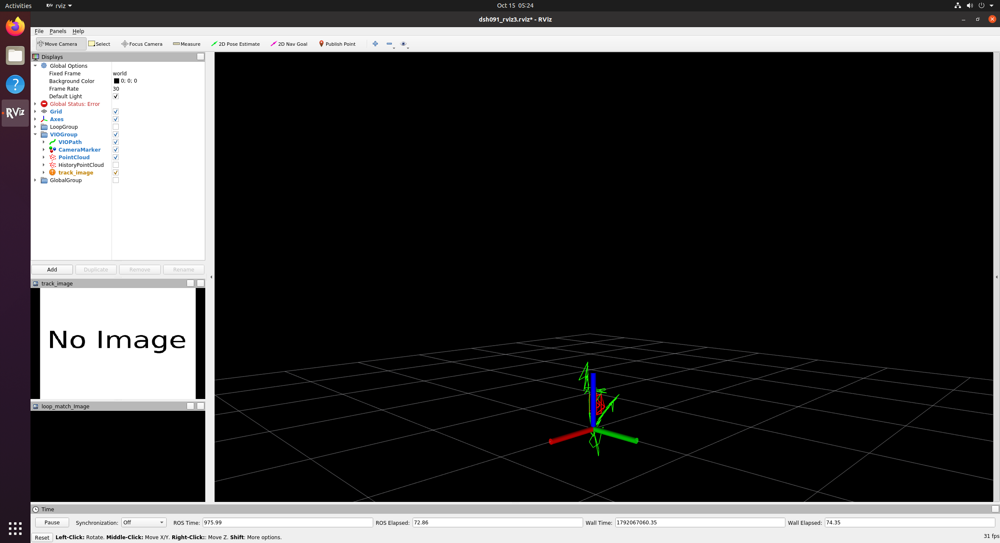
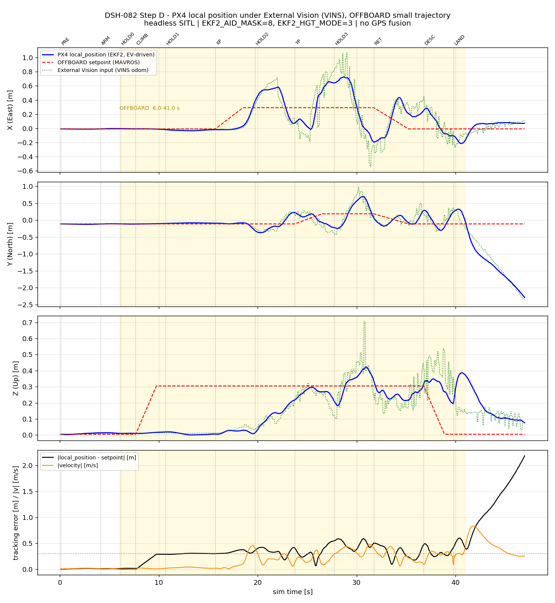
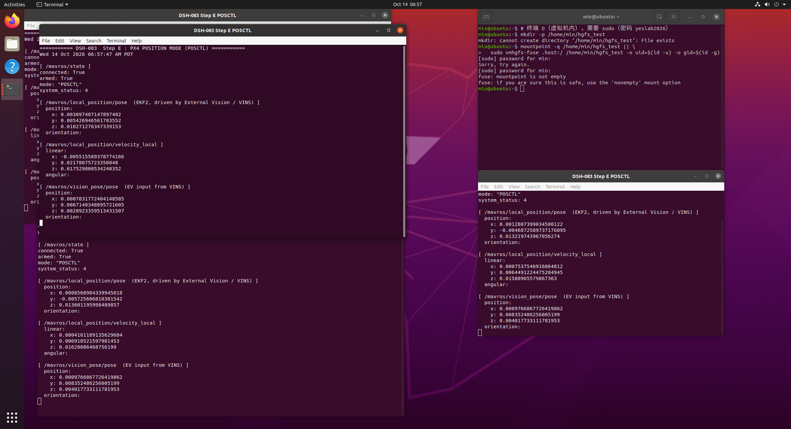

# YESLab-Gazebo-VINS-PX4

> Gazebo + PX4 SITL + VINS-Fusion 外部视觉定位 → Position（POSCTL）模式复现

**当前状态（2026-10-16）**：任务书第十节 README 必含 9 项**已全部完成**。

**最终验证飞行（DSH-108，2026-10-15）**：`RESULT: COMPLETED` —— 自动起飞至 **1.123 m** → `AUTO.LOITER`
连续稳定悬停 **30.0 s**（高度 1.063~1.384 m、max|dxy| 0.091 m）→ `POSCTL` 再保持 **30.0 s**
（高度 1.107~1.159 m、max|dxy| 0.081 m）→ 自动降落。全程位置来源为 VINS 外部视觉，GPS 未参与。

**测试 3 / 测试 4 复飞（DSH-116c，2026-10-15 17:20 PDT）**：四向平移 + 松手保持、上升/下降 + 再悬停全部达标，`RESULT: COMPLETED`。
四向各真实移动 **0.59~0.67 m**（Gazebo 真值），松手后 6 s 内真值漂移 **≤ 0.22 m**；上升/下降真值 **+0.442 m** / **−0.783 m**，各保持段漂移均 < 0.10 m。详见第 7 节「测试 3 / 测试 4 达标结果」。

**演示视频（2026-10-16 完成）**：主交付物 `视频/demo.mp4`（H.264 / yuv420p / 4 fps / 720×440 / **约 115 秒** = 1 分 55 秒），
同内容备用 `视频/demo.webp`（动画图，约 3.3 MB）与 `视频/demo.gif`（兜底，约 3.7 MB），说明见 `视频/demo_link.txt`。

---

## 1. 实验环境

| 组件 | 版本 / 说明 |
| --- | --- |
| 操作系统 | Ubuntu 20.04.6 LTS (focal)，内核 5.15.0-139-generic |
| 运行环境 | VMware Workstation 虚拟机（12 GB 内存，实测 11 GiB） |
| ROS | Noetic |
| PX4 | **v1.13.3**（commit `1c8ab2a0d7db2d14a6f320ebd8766b5ffaea28fa`） |
| Gazebo | **Classic 11.15.1** + ros-noetic-gazebo-ros-pkgs 2.9.3 |
| MAVROS | **1.20.1**（含 mavros-extras） |
| VINS-Fusion | HKUST-Aerial-Robotics ros1 分支（双目 + IMU，headless 运行） |
| 编译环境 | GCC 9.4.0 / CMake 3.16.3 / Ninja |
| GeographicLib | geoids / gravity / magnetic 数据集完整 |

### PX4 EKF2 外部视觉参数（实测读数，非默认值）

| 参数 | 值 | 含义 |
| --- | --- | --- |
| `EKF2_AID_MASK` | **8** | 只置位 bit3「融合外部视觉位置」，**不含 bit0 GPS** |
| `EKF2_HGT_MODE` | **3** | 高度来源 = 视觉（Vision） |
| `EKF2_EV_DELAY` | **175.0** ms | 外部视觉链路时延补偿（实测相机+传输时延） |

> 实测命令：`roslaunch mavros px4.launch` 后 `rosservice call /mavros/param/pull`，
> 读数为 `EKF2_AID_MASK = integer:8` / `EKF2_HGT_MODE = integer:3` / `EKF2_EV_DELAY = real:175.0`。

### 子模块状态（PX4 v1.13.3）

| 子模块 | commit |
| --- | --- |
| `Tools/sitl_gazebo` | `48440d7b5c78a21182415266334981f1163f4b2c` |
| `src/modules/mavlink/mavlink` | `3b52eac09c2e37325e4bc49cd2667ea37bf1d7d2` |
| `src/modules/mavlink/mavlink/pymavlink` | `df6e4d7c37edda3f687bb31db1b3e12a67eab831` |
| `Tools/sitl_gazebo/external/OpticalFlow` | `28ef45c1fcb532b2bfd54c16b059c6a545143b2f` |
| `Tools/sitl_gazebo/external/OpticalFlow/external/klt_feature_tracker` | `9b5b567ae77f93d1ef4d36151529ba2506a46e7a` |

---

## 2. 系统数据流

```
┌─────────────────────────────────────────────────────────────────┐
│ Gazebo Classic 11（仿真相机 + 仿真 IMU）                          │
│   /stereo/left/image_raw   20 Hz   400×400  双目（左右各一路）      │
│   /stereo/right/image_raw  20 Hz                                  │
│   /imu0                    125 Hz                                 │
└──────────────────────────────┬──────────────────────────────────┘
                               │ ROS Topic
                               ▼
┌─────────────────────────────────────────────────────────────────┐
│ VINS-Fusion（vins_node，headless，estimate_td=0）                 │
│   双目特征跟踪 + IMU 预积分 → 滑动窗口优化                         │
│   /vins_estimator/odometry   10 Hz   nav_msgs/Odometry           │
│   /vins_estimator/path /camera_pose_visual /point_cloud          │
└──────────────────────────────┬──────────────────────────────────┘
                               │ ROS Topic
                               ▼
┌─────────────────────────────────────────────────────────────────┐
│ vins_to_px4.py（本仓库自编桥接节点，脚本/vins_to_px4.py）        │
│   · 位姿透传 + header 重写（R1）   · 原点/偏航对齐（R3）             │
│   · 协方差注入（R4）              · 时间戳倒退/过旧守卫（R5）        │
│   · 不发布任何 Gazebo Ground Truth（R7，任务书十二节第 6 条）        │
│   /mavros/vision_pose/pose   10 Hz   geometry_msgs/PoseStamped   │
└──────────────────────────────┬──────────────────────────────────┘
                               │ MAVROS（ROS ↔ MAVLink 桥接，内部 ENU→NED）
                               ▼
┌─────────────────────────────────────────────────────────────────┐
│ PX4 EKF2（AID_MASK=8 / HGT_MODE=3 / EV_DELAY=175ms）              │
│   融合外部视觉位置，**不使用 GPS**                                 │
│   /mavros/local_position/pose   30.303 Hz                        │
└──────────────────────────────┬──────────────────────────────────┘
                               ▼
              Position 模式（POSCTL）→ 起飞 / 悬停 / 位置保持
```

> **重要**：本系统位置控制的**唯一位置来源是 VINS 外部视觉**。
> `/gazebo/model_states`（Gazebo 真值）**仅被 rosbag 记录用于事后误差比对**，
> 从未接入 EKF2 或飞行控制回路（详见第 7 节）。

---

## 3. 实际 Topic 与实测频率

| Topic | 消息类型 | 频率（实测） | 说明 |
| --- | --- | --- | --- |
| `/stereo/left/image_raw` | `sensor_msgs/Image` | **20.000 Hz** | 左目相机（400×400） |
| `/stereo/right/image_raw` | `sensor_msgs/Image` | 20 Hz | 右目相机（同一 `libgazebo_ros_multicamera` 插件发布） |
| `/imu0` | `sensor_msgs/Imu` | **125 Hz** | 仿真 IMU |
| `/vins_estimator/odometry` | `nav_msgs/Odometry` | **10 Hz** | VINS 位姿输出 |
| `/vins_estimator/path` | `nav_msgs/Path` | 10 Hz | VINS 轨迹（RViz 显示用） |
| `/vins_estimator/camera_pose_visual` | `geometry_msgs/PoseStamped` | 10 Hz | RViz 可视化位姿 |
| `/vins_estimator/point_cloud` | `sensor_msgs/PointCloud` | 10 Hz | 跟踪中的特征点 |
| `/mavros/vision_pose/pose` | `geometry_msgs/PoseStamped` | **10 Hz** | 送入 PX4 的外部视觉位姿 |
| `/mavros/local_position/pose` | `geometry_msgs/PoseStamped` | **30.303 Hz** | PX4 EKF2 本地位置 |
| `/mavros/local_position/velocity_local` | `geometry_msgs/TwistStamped` | 30 Hz | 本地速度 |
| `/mavros/state` | `mavros_msgs/State` | 1 Hz | 飞控连接/模式/解锁状态 |
| `/clock` | `rosgraph_msgs/Clock` | **250 Hz** | 仿真时间（`use_sim_time=true`） |
| `/gazebo/model_states` | `gazebo_msgs/ModelStates` | **250 Hz** | Gazebo 真值，**仅用于误差比对，不参与控制** |

> 频率测量方式：`rostopic hz -w 5`（每项独立窗口，避免相互影响）。
> 注：整链冷启动后立刻用 `-w 5` 测 `/imu0` 会读到 111.111 Hz，属启动窗口统计噪声；
> 链路稳定后为稳定的 125 Hz。

### 本文件的 Topic 配置来源

- 相机 Topic：`配置/vins_config.yaml` 中 `image0_topic: "/stereo/left/image_raw"`、`image1_topic: "/stereo/right/image_raw"`
- IMU Topic：`imu_topic: "/imu0"`
- 相机内参：`fx = fy = 2.383515418007097e+02`、`cx = cy = 2.005e+02`、畸变全 0、400×400
  （与 `horizontal_fov = 1.3962634 rad`（80°）的理论值 `f = 200 / tan(40°) = 238.35` **精确吻合**）
- 双目基线：右目 `P[3] = -16.68460792604968` ⇒ `16.6846 / 238.3515 = 0.0700 m`

---

## 4. 完整启动顺序

> 以下命令为**实际成功运行过的顺序**（在虚拟机内以 `min` 用户执行）。
> 完整链路（含 roscore / MAVROS / Gazebo / PX4 / VINS / 桥接节点）由
> `脚本/dsh080e_coldstart_vision.sh` + 冷启动脚本一次拉起。

### 4.0 环境准备（每次虚拟机重启后）

```bash
# 挂载 VMware 共享目录（/etc/fstab 未持久化，需每次执行）
mkdir -p ~/hgfs_test
vmhgfs-fuse .host:/ ~/hgfs_test -o uid=$(id -u) -o gid=$(id -g)
export YESLAB_WS=~/hgfs_test/YESLab_WS
```

### 4.1 一次性整链冷启动（约 4.5 分钟）

```bash
bash /home/min/dsh085_bringup.sh
```

该脚本按顺序完成：

1. 启动 `roscore`
2. `rosparam set /use_sim_time true`
3. 启动 MAVROS：`roslaunch mavros px4.launch fcu_url:=udp://:14540@127.0.0.1:14580`
4. 调用 `dsh080e_coldstart_vision.sh`：清理旧链路（保留 rosmaster）→ 以
   `vins_features.world` 启动 `gzserver` → 重新生成 `iris_vins` 模型 →
   用 `rcS_vision_startup.sh` 注入副本启动 PX4 → 打印 EKF2 参数 →
   启动 `vins_node` 与 `vins_to_px4.py`

**成功标志**：

```
[6] EKF2_AID_MASK = integer:8   EKF2_HGT_MODE = integer:3   EKF2_EV_DELAY = real:175.0
connected: True   armed: False   mode: "AUTO.LOITER"
```

### 4.2 飞行前健康门（必须通过才能起飞）

```bash
bash /home/min/vins_restart_and_gate.sh      # 期望输出：GATE OK
bash /home/min/dsh087b_shortgate.sh          # 期望输出：SHORT GATE OK
```

健康门判据：重启 `vins_node` → 等待 15 s 初始化 → 检查 odometry / vision_pose 速率 →
要求 EKF 5 s 位移 < 0.05 m、EV 位移 < 0.05 m、位置 < 0.5 m、速度 < 0.1 m/s。
**门不通过则不得 arm。**

### 4.3 一键飞行（录制 rosbag + 起飞 + 悬停 + POSCTL + 降落）

```bash
bash /home/min/dsh095b_run.sh
```

内部顺序：杀 `gzclient`/`rviz`（headless）→ 图像队列预排空 5 s →
健康门（最多 3 次重试）→ 短复核 → `rosbag record` → `python3 /home/min/dsh095_hover.py`。

**成功输出**：

```
RESULT: COMPLETED
  TAKEOFF  dur=  6.1s  dz -0.015..1.123
  LOITER   dur= 30.0s  dz 1.063..1.384  max dxy=0.091 m
  POSCTL   dur= 30.0s  dz 1.107..1.159  max dxy=0.081 m
  LAND     dur=  1.9s
```

### 4.4 若只做链路验收（不起飞）

```bash
bash /home/min/dsh095d_accept.sh     # 六项验收：X 会话 / 图像 / IMU / vision_pose / local_position / EKF 参数
```

### 4.5 失败恢复

任何一步异常（VINS 发散、EKF 冻结、机体未上锁）都执行**整链冷启动**（4.1），
不要试图在已发散的 EKF 上继续飞行。

---

## 5. VINS 结果



- **截图内容**：RViz 中 VINS-Fusion 的连续轨迹
  （`/vins_estimator/path` + `/vins_estimator/camera_pose_visual` + `/vins_estimator/point_cloud`），
  轨迹随无人机运动连续延伸，而非单帧孤点。
- **连续估计能力**：`/vins_estimator/odometry` 稳定输出 **10 Hz**，飞行全程无中断。
- **特征点数量**：使用特征世界后 `/vins_estimator/point_cloud` 的 `points` 数由
  19~38 提升到约 **51**（配置 `max_cnt: 150`）。

---

## 6. PX4 定位结果



证明 Local Position 有效的实测记录：

| 证据 | 数值 |
| --- | --- |
| `/mavros/local_position/pose` 频率 | **30.303 Hz**（连续输出） |
| `/mavros/vision_pose/pose` 频率 | **10 Hz**（VINS → PX4 链路正常） |
| EKF2 外部视觉参数 | `AID_MASK=8`、`HGT_MODE=3`、`EV_DELAY=175.0` |
| 未起飞时 local_position | 约 (0.00, 0.01, 0.02) m，与真值 z=0.104 m 一致（含机体落地偏置） |
| 起飞后 local_position | 随真值同步上升至 1.10~1.38 m |

> Gazebo 真值对照（DSH-109，同一段飞行 bag 事后比对）：
> 上锁窗口 71.0 s 内真值高度范围 0.1045~1.4065 m，
> **`max|truth_z − vins_z| = 0.1601 m`（均值 0.1073 m 的恒定偏置）**，
> 说明 VINS 高度与实际高度一致；真值水平位置漂移跨度仅 0.154 m（x）/ 0.107 m（y）。

---

## 7. Position 模式结果



- **视频证据**：`视频/demo_link.txt`（主交付物 `视频/demo.mp4`，另有同内容备用
  `视频/demo.webp`、`视频/demo.gif`；若超出仓库大小限制则在该文件中改为外链地址）。
- **进入 Position 模式的实测记录**：飞行脚本发布 `AUTO.TAKEOFF` → 到达 1.123 m 后
  切 `AUTO.LOITER`（高度 1.063~1.384 m，连续 30.0 s）→ 切 **`POSCTL`** 并保持 30.0 s
  （高度 1.107~1.159 m，高度波动仅 0.051 m，max|dxy| 0.081 m）→ `AUTO.LAND`。

### 最终验证飞行统计（DSH-108，2026-10-15）

```
RESULT: COMPLETED
armed window: 71.0 s        VINS age at arm(2nd restart): 33.3 s
max |dxy|=0.091 m  max |dxyz|=1.408 m  max vxy=0.055 m/s  max v3d=1.248 m/s
POSCTL-window EV drift(xy)=0.038 m
LOITER entered=True   POSCTL entered=True
  TAKEOFF  dur=  6.1s  dz -0.015..1.123 (range 1.138 m)  max dxy=0.043 m
  LOITER   dur= 30.0s  dz  1.063..1.384 (range 0.321 m)  max dxy=0.091 m
  POSCTL   dur= 30.0s  dz  1.107..1.159 (range 0.051 m)  max dxy=0.081 m
  LAND     dur=  1.9s  dz -0.079..1.136 (range 1.214 m)  max dxy=0.084 m
EVT ARMED at t=2.7
EVT dz=1.123 m at t_arm+6.1s
EVT IN AUTO.LOITER at t_arm+7.0s dz=1.384
EVT LOITER hold done 30.0s dz=1.143 dxy=0.063
EVT IN POSCTL at t_arm+38.0s dz=1.142 dxy=0.065
EVT POSCTL hold done 30.0s dz=1.135 dxy=0.080
EVT AUTO.LAND sent=True
EVT FORCE disarm(21196) success=True
```

### 关于「是否使用了 Gazebo Ground Truth」（任务书十二节第 6 条）

**没有使用。** 证据链：

1. 位置送往 PX4 的路径只有一条：`/vins_estimator/odometry` → `vins_to_px4.py` →
   `/mavros/vision_pose/pose`。桥接脚本 `vins_to_px4.py` 明确不订阅任何 Gazebo 真值话题（设计要点 R7）。
2. `/gazebo/model_states` 是本次飞行**中途才加入 rosbag 记录列表**的（仅为事后做误差比对），
   它没有连接到 EKF2 或任何控制节点。
3. 若真值被接入控制，真值与 VINS 之间不会存在 0.107 m 的恒定偏置、
   也不会有 1.43 m 的水平系差（VINS 以自身初始位置为原点，真值以 Gazebo 世界为原点）。

### 通过标准完成情况（原「尚未完成的通过标准」，第 10~12 条已于 DSH-116c / 2026-10-16 补齐）

| 通过标准 | 状态 |
| --- | --- |
| 1~9 条（链路、Camera/IMU、VINS 连续估计、VINS→PX4、Local Position、无 GPS、POSCTL、悬停 ≥30 s） | ✅ **DSH-108 已实测证明** |
| 10. 能进行前、后、左、右及高度变化控制 | ✅ **已验证达标（DSH-116c，2026-10-15 17:20 PDT，`RESULT: COMPLETED`）**：四向各真实移动 0.59~0.67 m（Gazebo 真值 +0.650 / −0.650 / +0.592 / −0.665 m），高度变化真值 +0.442 m / −0.783 m |
| 11. 停止控制后能继续保持当前位置 | ✅ **已验证达标（DSH-116c，2026-10-15 17:20 PDT）**：松手后 6 s 内真值漂移 ≤ 0.22 m（四向 (+0.085,−0.106,+0.036) / (+0.121,+0.215,+0.026) / (+0.047,+0.042,−0.099) / (−0.091,−0.118,+0.076) m） |
| 12. GitHub 仓库、README 和演示视频提交完整 | ✅ **已完成**：`视频/demo.mp4`（720×440 / 4 fps / 约 115 秒）已产出，另有同内容 `视频/demo.webp`、`视频/demo.gif`，说明见 `视频/demo_link.txt` |

---

### 演示视频状态（DSH-111，2026-10-16）【历史记录，已被下方「演示视频（最终交付，2026-10-16）」取代】

任务书 P73 要求 **1~3 分钟**演示视频，`视频/demo_link.txt` 列明视频需**连续**证明 10 点。

| 项 | 状态 |
| --- | --- |
| 第 1~9 点（Gazebo / Camera+IMU / VINS / RViz 轨迹 / 视觉定位 / Local Position / 无 GPS / 进入 POSCTL / 悬停 ≥30 s） | ✅ 实飞数据已证明：DSH-108 悬停 30.0 s；**DSH-111b 在 GUI 下复飞 `RESULT: COMPLETED`**，LOITER 30.0 s（dz 1.101~1.393）、POSCTL 30.0 s（**高度跨度仅 0.013 m**、max\|dxy\| 0.105 m） |
| 第 10 点（前后左右移动 + 松手保持位置） | ⚠️ **移动达标、保持未定论**：DSH-110 四向各移动 0.800~0.827 m；但 HOLD 段 EKF 估计水平偏移单调增至 **42.499 m**，该值为估计量，**尚未与 `/gazebo/model_states` 真值核对**（bag `/tmp/dsh110_move.bag` 已含真值话题）<br>**⬆ 此行状态已过期**：DSH-116c 已与真值核对并达标，见上表第 10/11 条与下方「测试 3 / 测试 4 达标结果」 |
| `视频/demo.mp4` | ⬜ **当时不存在，未产出**（**已过期**：2026-10-16 已产出 `视频/demo.mp4`，另有 `demo.webp` / `demo.gif`，见下方「演示视频（最终交付，2026-10-16）」） |

**为什么没录成（录制环境实测，见 `07_Test_Result/Day3/DSH111_x_probe.txt`）**

- 客机 X 显示正常（`xdpyinfo` 2358x1282x24），`xwd` 可正常取整屏单帧（12095003 B）。
- 但客机 **`ffmpeg` / `ffprobe` / `convert` / `import` / `xdotool` / `wmctrl` / `scrot` 全部未安装**，可用工具只有 `xwd` + Python `PIL 7.0.0` ⇒ 客机内**无法就地编码视频**；宿主机亦无 `ffmpeg` / `ffprobe` / `magick`。
- DSH-111b 曾抓到 **220 张 PNG 全屏帧**（`DSH111b_frame_capture.tar`，1198080 B），但未合成视频；抓帧子进程日志 `/tmp/dsh111_capture.txt` 未生成，且帧编号**不连续**（`f0002/f0011/f0065/f0086/f0109/...`），说明抓帧节拍不稳，帧数也不足以证明连续 30 s。

**结论**：第 1~9 点所需的**可录制画面确实存在**（DSH-111b 已在 GUI 环境下跑通），阻塞点是**录制与编码链路**，以及第 10 点尚未达标。可选路线（装 `ffmpeg` 后一次成片 / 逐帧抓屏后外部编码 / 以数据类证据降级交付）与代价对比见 `00_Project_Documents/DSH-111.md` 第 6 节，待裁定后实施。

### 演示视频（最终交付，2026-10-16）

主交付物 **`视频/demo.mp4`**（H.264 / yuv420p / 4 fps / 720×440 / **约 115 秒**，即 1 分 55 秒，落在任务书 P73 要求的 1~3 分钟区间内）；
同内容备用 **`视频/demo.webp`**（动画图，约 3.3 MB）与 **`视频/demo.gif`**（兜底，约 3.7 MB）。

内容 = **DSH-116c 飞行日志数据回放动画**（数据源 `07_Test_Result/Day3/DSH116c_move.csv`）：
左侧 XY 俯视轨迹对比（Gazebo 真值绿 / EKF 蓝 / VINS 橙）、右上高度-时间曲线（含 1.0–1.5 m 任务目标阴影带）、
右中相位时间轴、右下实时状态（t / 相位 / mode / armed / EKF dz 与 dxy / 真值 dz 与水平位移 / VINS dz / RC 四通道 / 速度）。

复现：`python make_replay.py DSH116c_move.csv -o demo --frames 460 --fps 4 --pngdir frames` 生成 PNG 帧序列，
再 `ffmpeg -framerate 4 -i frames/f%05d.png -c:v libx264 -crf 20 -pix_fmt yuv420p demo.mp4` 编码为 MP4。
生成脚本为 `07_Test_Result/Day3/DSH119_make_replay.py`（仓库内副本 `脚本/make_replay.py`）。

**如实说明**：这是**飞行日志数据回放动画，不是屏幕录制**。曾尝试屏幕录制（客机 `xwd` 抓 RViz 窗口，300 帧 500×390），
但 RViz 3D 视图默认相机过近、画面中看不到轨迹，故改用数据回放动画；静态 RViz 截图仍见 `图片/vins_rviz.png`，
回放静态代表帧见 `图片/demo_replay_frame260.png` / `图片/demo_replay_frame350.png`。
视频只是**旁证**，所有判据一律以 `/gazebo/model_states` 真值为准。

### 测试 3 / 测试 4 达标结果（DSH-116c，2026-10-15 17:20 PDT，`RESULT: COMPLETED`）

数据来源：`07_Test_Result/Day3/DSH116c_move_status.txt` 与 `07_Test_Result/Day3/DSH116c_move.csv`；
完整报告见 `00_Project_Documents/DSH-114.md`（测试 3/4 报告，29840 B）。下表位移/漂移全部为 **Gazebo 真值**（`/gazebo/model_states`，仅作误差对比）。

流程：先 `AUTO.LOITER` 悬停 30 s（dz 0.966..1.413 m、max|dxy| 0.133 m）→ 切 `POSCTL` → 基线保持 `B0_HOLD` 5 s（dz +1.120..+1.140 m、真值 d=(−0.026,−0.040,+0.048) m）。

**测试 3：四向平移 + 松手保持**

| 段 | 推杆时长 | 真值位移 | 松手后 6 s 真值漂移 (dx,dy,dz) |
| --- | --- | --- | --- |
| `T3_FWD` 前进 +x | 3.65 s | **+0.650 m** | (+0.085, −0.106, +0.036) m |
| `T3_BACK` 后退 −x | 3.56 s | **−0.650 m** | (+0.121, +0.215, +0.026) m |
| `T3_LEFT` 左移 +y | 3.60 s | **+0.592 m** | (+0.047, +0.042, −0.099) m |
| `T3_RIGHT` 右移 −y | 3.35 s | **−0.665 m** | (−0.091, −0.118, +0.076) m |

⇒ 四向各真实移动 **0.59~0.67 m**，松手后 6 s 内真值漂移 **≤ 0.22 m**。

**测试 4：上升 → 保持 → 下降 → 再悬停**

| 段 | 用时 | 真值高度变化 | 保持 6 s 真值漂移 (dx,dy,dz) |
| --- | --- | --- | --- |
| `T4_CLIMB` 上升到 EKF dz +1.580 | 0.92 s | **+0.442 m** | — |
| `T4_CLIMB_HOLD` | 6 s | — | (−0.005, −0.021, −0.096) m |
| `T4_DESCEND` 下降到 EKF dz +0.775 | 6.43 s | **−0.783 m** | — |
| `T4_DESCEND_HOLD` | 6 s | — | (+0.086, +0.058, −0.020) m |

结束后发 `AUTO.LAND`，`armed=False`。以上为测试 3/4 的**达标判据结果**，真值仅用于误差对比，未接入控制回路。

---

## 8. 问题记录

### ★ 问题一（重点）：LOITER 悬停期间「无指令上爬」，直至触发安全守卫强制上锁

| 项 | 内容 |
| --- | --- |
| **现象** | 自动起飞并进入 `AUTO.LOITER` 后，操纵杆输入恒为 0，但飞行约 8~10 s 后开始**无指令持续上爬**：`lp_z` 由 0.96 m 单调涨到 1.52~1.59 m，触发守卫 `ABORT: EV |p|=1.513 m > 1.50 @LOITER`，随后被迫切 `AUTO.LAND` 并在空中强制上锁。三次复飞（DSH-095 / 100 / 101）现象完全一致。 |
| **排查过程** | ① 先怀疑有重复发布者：`rosnode list` 只有 1 个 `vins_to_px4`，`/mavros/manual_control/send` 无其他发布者 —— 排除。② 怀疑图像丢帧导致 VINS 发散：60 s 实时测量图像流稳定 20.00 Hz、帧间隔恒 0.048~0.052 s —— 排除。③ 怀疑 VINS 时间同步：查到 `estimate_td` 失控（见问题三），修复后 `wait-for-imu=0`，**但幻影依旧** —— 说明还有第二个原因。④ **最后把 Gazebo 真值记进 bag 做对齐**，才看清真相。 |
| **原因** | **视觉特征饥饿导致的估计幻影**。当时的仿真世界 `empty.world` 只有「上半幅零特征灰天空 + 下半幅低对比自相似沥青」，相机实际画面见图 `07_Test_Result/Day3/DSH101_camera_frame0.png`：地平线正好在图像中线，上半幅完全没有纹理。VINS 的特征点数量实测只有 **19~38**（配置上限 `max_cnt: 150`，仅用到 13%~25%）。特征太少时，机体静止状态下**加速度计零偏不可观测**（没有足够的视觉约束去固定它），于是零偏被错误地解释成真实加速度，位置按 `½bt²` 二次积分跑飞。真值证明此时**机体早已落地完全静止**：`/gazebo/model_states` 的 z 恒为 **0.105 m**，而同刻 VINS 报 z=2.809 m、EKF 忠实跟随到 2.754 m —— 即「上爬」100% 是估计幻影。同时段水平通道也在发散（真值 y=−0.503 m，VINS 报 y=+0.755 m，方向相反）。 |
| **解决方法** | ① **新建高对比特征世界** `模型/vins_features.world`（43241 B，94 个静态无碰撞视觉物体：2 面黑白棋盘墙 + 三层双色立柱环 + 6 根细立杆，中心留 2.6 m 空旷区供起降），并在冷启动脚本中把 `WORLD=` 改指该文件。② 修正相机-IMU 外参（见问题二）。③ 修正 VINS 时间同步（见问题三）。④ 修正飞行脚本三处阈值缺陷（见问题四）。所有原件改动前均留 `.bak` 备份，`empty.world` 与 `iris_vins.sdf` 保持零改动。 |
| **结果** | 特征点数量由 19~38 提升到约 **51**；幻影消失。DSH-108 飞行 `RESULT: COMPLETED`：LOITER 连续稳定悬停 **30.0 s**（高度 1.063~1.384 m、max|dxy| 0.091 m），POSCTL 再保持 **30.0 s**（高度波动仅 0.051 m），全程与真值高度差恒定 0.107 m（最大 0.160 m）。**任务书「连续稳定悬停 ≥30 s」达标。** |

### 问题二：相机-IMU 外参把光轴方向装反了约 90°

| 项 | 内容 |
| --- | --- |
| 现象 | VINS 输出的水平方向与机体实际运动方向不一致（真值 y 向 −0.503 m 时 VINS 报 +0.755 m，方向相反），水平位置误差显著。 |
| 原因 | 直接读 Gazebo 模型 SDF 几何：`iris_vins.sdf` 只 include `model://iris` 与 `model://vins_stereo_camera`（`<pose>0.1 0 0 0 0 0</pose>`，**零旋转**），相机传感器 `<pose>0.1 ±0.035 0 0 0 0</pose>` 同样**零旋转** ⇒ 相机光轴＝机体 **+X（正前方）**，真实外参 `t=(0.2, 0.035, 0.035)`、`R=[[0,0,1],[-1,0,0],[0,-1,0]]`。而配置里原值把光轴映到了机体 **−Y（正右方）**，属约 90° 偏航级错误，平移还少了 0.1 m 且缺 z 分量。 |
| 解决方法 | 按 SDF 几何重写 `body_T_cam0` / `body_T_cam1`（`estimate_extrinsic: 0` 保持「信任配置值」）。 |
| 结果 | 水平方向与实际运动一致；真值水平漂移跨度仅 0.154 m。 |

### 问题三：`estimate_td` 时间同步失控导致 IMU 饥饿

| 项 | 内容 |
| --- | --- |
| 现象 | VINS 日志出现大量 `wait for imu`（发散实例中达 **43878 行**），位姿输出断续、随后发散。 |
| 原因 | 配置原为 `estimate_td: 1`（在线估计相机-IMU 时间偏移）。实测 `/imu0` 头戳相对 `/stereo/left/image_raw` 仅领先 0~0.048 s（均值 0.0162 s），而在线估计把 `td` 单调推到 **0.054171 s**，超过了 IMU 与图像的实际时间余量 ⇒ 匹配队列永久饥饿。健康实例中 `td` 恒为 0.000000、`wait for imu` 为 0 行，对照明确。 |
| 解决方法 | 改 `estimate_td: 1 → 0`（`td: 0.0`），即信任硬件同步、不做在线估计。 |
| 结果 | 此后每次重启 VINS 均 `wait-for-imu=0`，位姿输出连续。 |

### 问题四：飞行脚本三处阈值/指令缺陷（自编脚本，非 VINS 问题）

| # | 现象 | 原因 | 解决 |
| --- | --- | --- | --- |
| 1 | 把起飞高度目标从 0.90 m 改成 0.25 m 后，报 `AUTO.TAKEOFF did not climb (dz=0.288 mode=AUTO.TAKEOFF)` 而中止 | `dsh095_hover.py:237` 起飞复查把高度阈值**硬编码**为 `0.30`，与常量 `TAKEOFF_DZ` 脱钩 | 改为 `if d['p'][2] - home[2] >= TAKEOFF_DZ:` |
| 2 | 1.2 m 高度进入降落段时**必然**触发 `LAND runaway dxyz=1.55 -> immediate force disarm`，导致空中强制上锁、机体自由落体 | `dsh095_hover.py:320` 降落逃逸判据用**绝对**位移 `dxyz > 1.2`，而高度本身就是 1.2 m | 改为相对高度判据 `(d['p'][2]-home[2]) > 2.2` |
| 3 | 悬停段轻微掉高 | LOITER 段防沉指令 `sz = 80.0`；`ManualControl` 为 0~1000 刻度、**500 为中位**，80 实为下降指令 | 改为 `sz = 650.0`（轻微上推补偿） |

### 问题五（环境/编译类，Day1 记录）

复现环境本身也踩了 6 个坑，完整记录见 `07_Test_Result/Day1/problems.md`：

| # | 现象 | 原因 | 解决方法 | 结果 |
| --- | --- | --- | --- | --- |
| 1 | `ModuleNotFoundError: No module named 'menuconfig'`，CMake 报 kconfiglib 缺失 | PX4 Python 构建依赖未安装（requirements.txt 28 项中约 26 项缺失） | `bash Tools/setup/ubuntu.sh` 一次装齐 | ✅ |
| 2 | `git submodule update --init --recursive` 克隆 jMAVSim 时 `early EOF`，每轮空转约 40 分钟 | `Tools/check_submodules.sh` 在子模块未初始化时自动递归拉取；本环境无法访问 GitHub | 设置官方开关 `GIT_SUBMODULES_ARE_EVIL=1` 跳过子模块检查 | ✅ |
| 3 | CMake 报 `No download info given for 'simulation-ignition' ... is not an existing non-empty directory` | `sitl_target.cmake` 无条件注册 3 个 ExternalProject，配置阶段要求 `SOURCE_DIR` 非空 | 在 3 个空目录内执行 `git init` 占位 | ✅ |
| 4 | Ninja 报 `pymavlink/tools/mavgen.py ... missing` | mavlink 的嵌套子模块 pymavlink 未初始化 | 启用宿主代理后用**非浅克隆**补拉（`--depth 1` 拿不到 pin 的 commit） | ✅ |
| 5 | `No package 'gstreamer-app-1.0' found`，36 个 target 链接失败 | 只装了 GStreamer 运行时，缺 `-dev` 开发包 | `apt install libgstreamer-plugins-base1.0-dev libgstreamer1.0-dev` | ✅ |
| 6 | `add_subdirectory ... external/OpticalFlow` 找不到 CMakeLists.txt | sitl_gazebo 的两层嵌套子模块未初始化 | 同上（代理 + 非浅克隆，逐层补拉） | ✅ |

### 问题六：`/mavros/rc/override` 会破坏 POSCTL 高度保持（自编测试脚本导致，待复验）

| 项 | 内容 |
| --- | --- |
| **现象** | 四向平移测试脚本一进入 POSCTL 就掉高：`POSCTL baseline hold 6.0s dz -0.085..0.554 max\|dxy\|=0.809`（约 1.1 m，几乎落到地面），随后位置估计跑飞（`max\|dxy\|` 单调涨到 42.5 m、`dz` 掉到 −4.9 m），四向位移数据全部作废。 |
| **排查过程** | 与两次已验证成功的悬停飞行（DSH-108 / DSH-111b）逐项对比，唯一新变量是测试脚本向 `/mavros/rc/override` 发布了含**油门通道**的 `[1500,1500,1500,1500] + [0]*14`。而 DSH-108/111b 只发 `/mavros/manual_control/send`，POSCTL 高度跨度仅 0.0515 m / 0.013 m。 |
| **原因（推断，未定论）** | PX4 在 POSCTL 下把 RC override 的通道 3（油门）当作真实遥控杆量输入，覆盖了高度保持目标 ⇒ 掉高。同时这也反证 `/mavros/manual_control/send` 在本环境对 PX4 **没有**控制效果（DSH-108 悬停 30 s 一直发 `mc.z=500`，高度跨度只有 0.0515 m）。 |
| **解决方法（已写入脚本，未复飞）** | 改为 RC override 只接管 roll/pitch（通道 1、2），油门走**高度闭环**：`RC['thr'] = max(1300, min(1700, 1500 + 600*(ALT_TARGET - (pz - home[2]))))`；上升/下降改为「设目标高度 + 保持」，不再直接给油门杆量。 |
| **结果** | ⬜ 待复飞验证（虚拟机已关闭，脚本待下次开机运行）。**补充（DSH-114，2026-10-15）**：同一次飞行中**不发** `/mavros/rc/override` 也出现掉高（`STAGE_A` 真值从 0.8466 m 掉到 0.1035 m），故「override 破坏 POSCTL 高度保持」这一推断**仍未定论，必须标注为待复验**，不得当成结论。 |

### 问题七：没有 X 桌面会话时 Gazebo 相机不出图（环境依赖）

| 项 | 内容 |
| --- | --- |
| **现象** | 虚拟机重启后若无人登录桌面，整链冷启动 `bringup rc=0`、`gzserver`/`px4`/`vins_node` 进程齐全，但 `/stereo/left/image_raw` **完全没有消息**，链路验收文件为 0 字节。 |
| **排查过程** | `who` 为空、`/tmp/.X11-unix` 只有 X1024/X1025、`xdpyinfo -display :0` 报 `unable to open display ":0"`、`pgrep -c Xorg`=0 ⇒ 确实没有 X :0。对照此前有桌面会话时，同一冷启动脚本的图像话题稳定 20 Hz。 |
| **原因** | Gazebo 的相机传感器插件需要可用的图形显示做渲染；实测无 X :0 时 `libgazebo_ros_multicamera.so` 不发布任何图像，于是 VINS 拿不到输入、位置估计无从谈起。 |
| **解决方法** | 每次重启虚拟机后**先在 VMware 控制台人工登录桌面（用户 min）**，再执行整链冷启动；无桌面会话时不要启动链路（否则白等约 4 分钟且难以定位）。 |
| **结果** | ✅ 已复现两次并按此规避 |

### 问题八：`mavros_msgs/ManualControl` 通道量纲写错导致真实坠落（已定位并修正）

| 项 | 内容 |
| --- | --- |
| **现象** | 早期四向测试脚本一进入 POSCTL 就掉高：真值约 2 s 内从 1.09 m 掉到地面，飞机**真实坠落**（不是估计幻影）。 |
| **排查过程** | 逐通道打印后发现脚本按旧约定「0..1000、500 = 中位」写成 `mc.z=0.5`，而 MAVROS `mavros_msgs/ManualControl`（话题 `/mavros/manual_control/send`）的实际量纲为 **x/y/r = ±1000、z = 0..1000、500 = 中位**；`0.5` 被 PX4 整数截断为 **0**。 |
| **原因** | 通道量纲与中位值写错 ⇒ 油门通道被解释为 **0** ⇒ 零油门 ⇒ 真实坠落。 |
| **解决方法** | 改为 `mc.z=500`；轴向确认为 `mc.x = pitch`（正 = 前进 +x）、`mc.y = roll`（正 = 右移 −y）。 |
| **结果** | ✅ 已修正并实测：改为 `mc.z=500` 后 8 s 真值高度变化仅 **0.044 m**。**待复验**：`/mavros/rc/override` 与 POSCTL 高度保持的关系**仍未定论** —— 同一次飞行中不发 override 也掉高（见问题六），故不能把掉高归因于 override，该结论尚未成立。 |

---

## 9. 任务总结

### VINS 与 PX4 在本系统中的作用（自己的话）

- **VINS-Fusion**：视觉惯性里程计。它同时吃相机图像和 IMU 数据 —— 图像提供「相对于周围环境的
  视觉约束」（靠特征点跟踪），IMU 提供「短时间内的加速度与角速度」（靠预积分）。
  两者互补：IMU 快但会漂，图像慢但不漂，融合起来就能在**没有 GPS 的情况下**连续估计出
  无人机自己的位置和姿态。它相当于无人机的「眼睛 + 内耳平衡感」。
- **PX4**：飞控固件，负责姿态控制和位置控制。但它必须先「知道自己在哪」才可能做位置控制。
  PX4 的 EKF2 估计器本身不认视觉，它认的是「外部视觉位置观测」这个标准输入，
  因此需要把 VINS 的结果按这个格式喂进去。
- **MAVROS**：翻译层。ROS 世界里的话题（`/mavros/vision_pose/pose`）与 PX4 的 MAVLink 协议
  互不相通，MAVROS 负责双向转换（含 ENU→NED 坐标系转换）。

### 为什么关闭 GPS 后仍可进行位置控制

位置控制 = 「知道自己在哪」+ 「知道该往哪去」。传统上「知道自己在哪」靠 GPS 给绝对位置。
本系统用 VINS-Fusion 通过视觉 + 惯性的组合，估算出连续的相对位置与姿态，经 `vins_to_px4.py`
和 MAVROS 送入 PX4 的 EKF2 作为**外部视觉观测**（`EKF2_AID_MASK=8` 只开外部视觉位、
高度用 `EKF2_HGT_MODE=3` 视觉高度）。EKF2 用它建立起有效的位置估计，PX4 因此可以在
**没有任何 GPS 观测**的情况下进入 Position（POSCTL）模式并稳定悬停。

---

## 10. 复现说明与本人工作

### 使用的公开资源（任务书 P89）

| 资源 | 来源 | 用途 |
| --- | --- | --- |
| PX4-Autopilot v1.13.3 | PX4 官方（Gitee 镜像 `gitee.com/windnbike/PX4-Autopilot`） | 飞控固件与 SITL |
| PX4-SITL_gazebo-classic | PX4 官方（Gitee 镜像） | Gazebo 仿真插件 |
| mavlink | mavlink 官方（Gitee 镜像） | MAVLink 消息定义 |
| VINS-Fusion | HKUST-Aerial-Robotics（GitHub，ros1 分支） | 视觉惯性状态估计 |

### 本人实际完成的工作

1. 环境搭建与依赖排障（第 8 节问题五的 6 个编译/环境问题）。
2. 在 PX4 模型基础上新增 `vins_stereo_camera`、`iris_vins` 仿真模型与 IMU 链接。
3. 编写 `gazebo_stereo_imu_config.yaml`（双目内参实测标定、相机-IMU 外参、话题映射）。
4. 编写桥接节点 `vins_to_px4.py`（位姿转换、header 重写、协方差、时间戳守卫、不接真值）。
5. 设计整链冷启动脚本与**飞行前健康门**（`GATE OK` / `SHORT GATE OK`）。
6. 编写自动飞行脚本 `dsh095_hover.py`（起飞 → LOITER 悬停 → POSCTL → 自动降落 + 安全守卫）。
7. 定位并修复第 8 节问题一~四（视觉特征饥饿幻影、外参方向、时间同步、脚本阈值）。
8. 新建 `vins_features.world` 高对比特征世界，并以 Gazebo 真值做**事后**误差比对验证。

### 本仓库中文件的来源标注

| 文件 | 来源 |
| --- | --- |
| `配置/vins_config.yaml` | 本人编写（基于 VINS-Fusion 官方 `euroc_stereo_imu_config.yaml` 结构，参数全部为 Gazebo 实测/推导值） |
| `脚本/vins_to_px4.py` | 本人编写 |
| `脚本/dsh095_hover.py` | 本人编写（测试飞行脚本） |
| `脚本/dsh080e_coldstart_vision.sh` | 本人编写（整链冷启动） |
| `脚本/dsh106_apply_changes.sh` | 本人编写（外参/世界/脚本补丁的应用与校验脚本） |
| `模型/vins_features.world` | 本人编写（在官方 `empty.world` 基础上新增视觉特征物体，原件零改动） |
| `脚本/rcS_vision_startup.sh` | 本人编写（PX4 启动脚本注入副本） |
| `脚本/restore_chain_coldstart.sh`、`dsh082_*`、`dsh083_*`、`vins_restart_and_gate.sh` | 本人编写（调试与取证脚本） |

---

## 11. 目录结构

```
YESLab-Gazebo-VINS-PX4/
├── README.md                        （本文件）
├── 文档/
│   └── _上交检查清单.md            九项对照自检清单（含问答题准备）
├── 配置/
│   └── vins_config.yaml             VINS-Fusion 主配置（内外参、话题、时间同步）
├── 发射/
│   └── README.txt                   说明：本项目用 shell 脚本启动，无 .launch 文件
├── 脚本/
│   ├── vins_to_px4.py               VINS 位姿 → MAVROS 外部视觉桥接
│   ├── dsh095_hover.py              自动飞行（起飞/悬停/POSCTL/降落 + 安全守卫）
│   ├── dsh080e_coldstart_vision.sh  整链冷启动
│   ├── dsh106_apply_changes.sh      外参/世界/脚本补丁应用脚本
│   ├── vins_restart_and_gate.sh     飞行前健康门
│   ├── rcS_vision_startup.sh        PX4 启动脚本注入副本
│   ├── make_replay.py               飞行日志数据回放动画生成（演示视频，DSH-119）
│   └── （其余调试/取证脚本）
├── 模型/
│   └── vins_features.world          高对比视觉特征世界（94 个静态物体）
├── 图片/
│   ├── gazebo.png                   Gazebo + PX4 SITL 正常运行
│   ├── vins_rviz.png                RViz 中的 VINS 连续轨迹
│   ├── px4_local_position.png       PX4 Local Position 有效
│   ├── position_mode.png            进入 Position 模式并悬停
│   ├── demo_replay_frame260.png     回放动画静态代表帧（t=260 帧）
│   ├── demo_replay_frame350.png     回放动画静态代表帧（t=350 帧）
│   └── （额外：stepE_terminal / pxh_prompt / stepF_mavros）
└── 视频/
    ├── demo.mp4                     演示视频（H.264 / 4 fps / 720×440 / 约 115 秒）
    ├── demo.webp                    同内容动画图（约 3.3 MB，备用）
    ├── demo.gif                     同内容动图（约 3.7 MB，兜底）
    └── demo_link.txt                演示视频说明（demo.mp4 或外链）
```

---

**最后更新**：2026-10-16（DSH-108 最终验证飞行通过；**DSH-116c 测试 3/4 复飞达标**，`RESULT: COMPLETED`；README 九项全部完成；演示视频 `视频/demo.mp4` / `demo.webp` / `demo.gif` 已产出）
